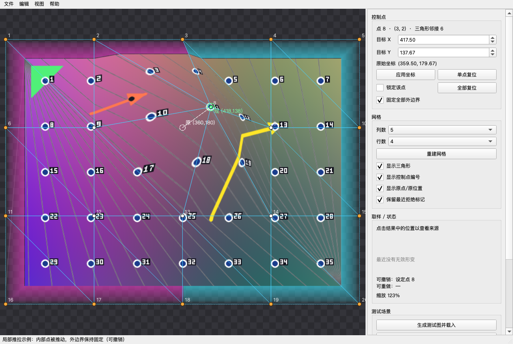
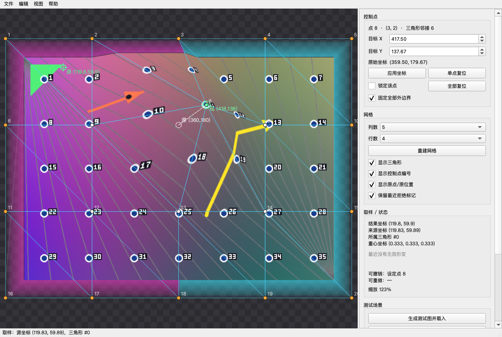
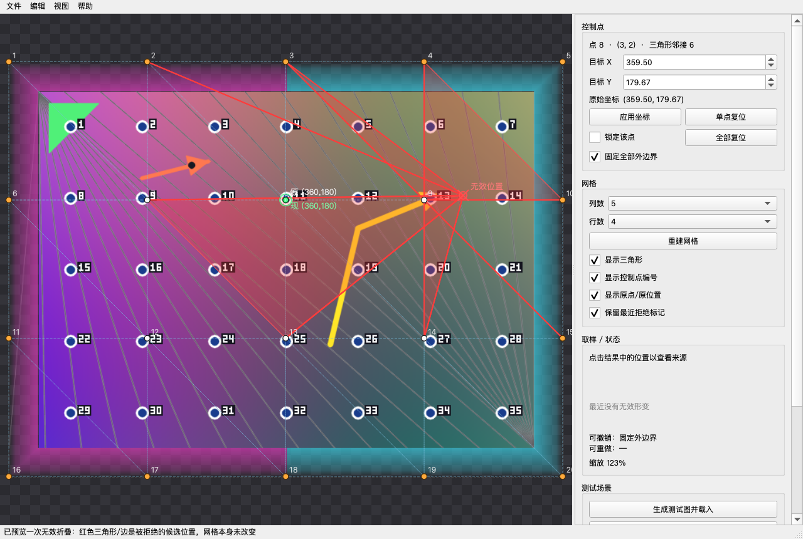

# Mesh Warp — 二维控制网格局部形变工具（macOS）

用固定的三角网格对一张 PNG 做**局部推拉变形**，同时可视化控制网格、实时判断
三角形是否翻转/退化/边交叉，并对无效位置明确拒绝。只做人工移动二维控制点，
不做镜头畸变拟合、自动配准、任意曲面或三维形变。

技术栈：Python 3.10+ · PySide6（桌面 UI）· OpenCV（重采样）· NumPy（几何）。



---

## 1. 安装与启动

```bash
# 在仓库根目录
./setup.sh                 # 创建 .venv 并安装 requirements.txt
./run.sh                   # 启动桌面应用
```

等价的手动方式：

```bash
python3 -m venv .venv
.venv/bin/python -m pip install -r requirements.txt
.venv/bin/python -m mesh_warp.app
# 或安装为命令后： mesh-warp
```

无显示环境的自检：

```bash
.venv/bin/python -m mesh_warp.cli selfcheck      # 像素级验证套件
.venv/bin/python -m pytest tests -q              # 65 项自动化测试
```

---

## 2. 功能与操作

### 2.1 载入与网格

* **文件 → 打开 PNG…**：仅接受 PNG；**长边不得超过 1200 px**（超限直接报错，
  不静默缩放，保证像素坐标有意义）。灰度/ RGB PNG 会自动补不透明 alpha。
* 载入后按当前分辨率（默认 **6×6**，可选 **4×4 … 8×8**）在**原图尺寸画布**上
  建立规则网格，边界点精确落在 `0` 与 `宽-1 / 高-1`。
* **网格 → 列数/行数 → 重建网格**：改变分辨率会重建网格。若当前已有形变，
  会弹出确认框提示**重建将清除已有形变与锁定状态**。
* 三角形连接关系在网格建立时固定，形变过程中**永不改变**；可勾选显示三角形。

### 2.2 移动控制点

| 操作 | 说明 |
| --- | --- |
| 拖动圆点 | 实时局部形变；拖动中显示该点**原始位置（虚线空心圈 + 数值）**和**当前位置**。拖动期间使用 700 px 预览渲染，松开后立即按原尺寸精确重绘 |
| 双击圆点 | 切换该点锁定（橙色为锁定） |
| 选中后在面板输入 X / Y | 输入目标**像素坐标**，改值即生效（“应用坐标”可再次确认）；无效值会拒绝并保留诊断 |
| “单点复位” / “全部复位” | 恢复该点 / 全部点至原始位置（可撤销） |
| “锁定该点” | 锁定点不可拖动、不可改坐标、不可单点复位 |
| “固定全部外边界” | 一次性锁定所有边界的点；锁定状态进撤销栈 |

视图操作：滚轮以鼠标位置为中心缩放；中键拖动或 **空格+拖动**平移；`F` 适应窗口。
缩放/平移只改变视图变换，**控制点坐标仍是图像像素坐标**，点击判定半径按屏幕
10 px 换算，因此放大缩小都不会改变点击位置与可点性。

### 2.3 形变与拒绝

图像按三角形做分段仿射变换：对每个目标像素求所在三角形与重心坐标，再映射回
源坐标重采样。相邻三角形共用边的两个端点相同，公共边两侧的映射在数学上完全一致，
不会出现裂缝、重复透明线或内容跳变。**没有移动控制点时直接返回原图（逐字节相同）**。

每次拖动都会把候选姿态整体校验，以下任一情况都会**拒绝该次位置**并保持最近一次
有效形变（不是隐藏坏三角形）：

* 三角形朝向翻转（有向面积符号改变或归零）；
* 三角形高度 < 0.5 px（接近零面积/退化），或面积低于静止面积的 1e-5；
* 两条不共享端点的网格边真正相交（边交叉）；
* 某个控制点严格落入不属于它的三角形内部（无交叉的包含式重叠）。

被拒绝时：画布上以红色高亮坏三角形与交叉边、显示红色候选点、右侧面板保留
“最近拒绝原因”，状态栏提示；网格与历史都不会改变，可以继续拖回正常区域。
按 `Esc` 可取消当前拖动。

### 2.4 取样（结果 → 来源）

在结果图上点击任意位置（不会命中控制点时即视为取样；按住 `Alt` 点击可在控制点上强制取样）：

* 若该位置被形变后的网格覆盖：显示**来源坐标、所属三角形编号、重心坐标**，
  并在画布上标出来源位置与“源 (x,y)”文字。
* 若网格未覆盖该位置（例如边界内缩后画布角落）：显示“**无来源**”，不编造坐标。



### 2.5 撤销 / 重做 / 复位

* 一次拖动 = **一步**撤销（拖动过程中多次移动只记一笔，松开才入栈；被拒绝的拖动不入栈）。
* 锁定/解锁、固定外边界、单点/全部复位同样进撤销栈。
* 撤销栈保存**目标坐标 + 锁定状态**，因此撤销“解锁”会恢复为锁定，反之亦然。
* 快捷键：`⌘Z` 撤销，`⇧⌘Z` 重做；菜单“编辑”中也有。

### 2.6 导出与回载

* **导出 PNG**：与原图同画布尺寸的透明 PNG，内容为纯形变结果，**不包含任何辅助线/点/标签**。
  画布外保持全透明（RGBA = 0,0,0,0）。
* **导出网格 JSON**：源/目标控制点坐标、锁定状态、固定拓扑三角形列表、图像尺寸与
  内容 SHA-256；坐标以双精度精确写出，回读后重新渲染与导出 PNG **逐像素一致**。
* **载入网格 JSON**：校验尺寸、内容哈希（同尺寸不同图会被拒绝）、源点是否为规则
  网格、三角形是否为固定拓扑、目标姿态是否有效；通过后恢复同样的形变与锁点状态。

### 2.7 内置测试图与三组场景

“生成测试图并载入”绘制 7×5 的**带编号格点**、**不对称箭头**（长折线箭头 + 短箭头 +
仅左上角的三角楔形）以及覆盖在透明边距上的**半透明渐变边框**。所有数字使用内置
3×5 点阵字模绘制，**不依赖任何外部字体文件**。

面板底部三组入口（都会载入内置测试图并重置为 5×4 网格）：

| 入口 | 内容 |
| --- | --- |
| 局部推拉示例 | 固定外边界，移动内部点产生可见的局部推拉形变 |
| 边界固定示例 | 全部外边界点锁定，并锁定一个内部参考点 |
| 无效折叠尝试 | 直接预览一次被拒绝的折叠：红色候选位置与坏三角形，网格本身不变 |



---

## 3. 文件格式

`mesh.json` 示例（省略部分点）：

```json
{
  "format": "mesh-warp-control-mesh",
  "version": 1,
  "image": {"width": 720, "height": 540, "sha256": "…", "path_hint": "内置测试图.png"},
  "grid": {"cols": 5, "rows": 4},
  "source_points": [[0.0, 0.0], [179.75, 0.0], "…"],
  "target_points": [[0.0, 0.0], [179.75, 0.0], "…"],
  "locked": [true, true, "…"],
  "triangles": [[0, 1, 6], [0, 6, 5], "…"]
}
```

点索引为 `j * cols + i`（`j` 为行、`i` 为列）。每格沿主对角线切成两个三角形。

---

## 4. 命令行（无 UI）

```bash
# 生成内置测试图
.venv/bin/python -m mesh_warp.cli fixture test_image.png

# 生成示例：source.png + warped.png + mesh.json
.venv/bin/python -m mesh_warp.cli demo demo_out

# 用已有网格 JSON 对图片重渲染（带图像哈希校验）
.venv/bin/python -m mesh_warp.cli warp source.png mesh.json out.png

# 查询某个结果像素的来源（无需原图，只需尺寸）
.venv/bin/python -m mesh_warp.cli sample mesh.json 400 250 --width 720 --height 540
```

---

## 5. 验证

### 5.1 自检套件

```bash
.venv/bin/python -m mesh_warp.cli selfcheck
```

| 检查 | 判据（实测值） |
| --- | --- |
| 恒等形变 | 未移动任何点时输出与源图**逐字节相同**（max diff = 0） |
| 已知控制点位置 | 模型坐标误差 0 px；把坐标斜坡图渲染后在目标像素解码来源坐标，误差 **0.71 px**（阈值 3 px） |
| 公共边连续 | 相邻三角形在共享边上的逆映射差 **2.3e-13 px**；无缝处 alpha 最小值 255；跨缝斜坡跳变 **2/255**（阈值 16） |
| 无效变形拒绝 | 翻转、退化到邻居、交换两点（边交叉）三类全部拒绝且状态不变 |
| 边界锁定 | 锁定时边界点不可移动；解锁后可移动 |
| 透明画布 / 无黑边 | 全透明像素的 RGB 全为 0；半透明区域无暗色像素 |
| 取样正确性 | 三角形重心往返误差 **7e-15 px**；网格未覆盖处返回“无来源” |
| 透明导出回读 | PNG 回读逐字节一致；重新渲染 max diff = 0；坐标与锁点完全一致 |

### 5.2 pytest

```bash
.venv/bin/python -m pytest tests -q
```

覆盖：

* `test_mesh.py`：网格分辨率约束、拓扑固定、共享边计数、翻转/退化/边交叉/包含式
  重叠（无交叉情况）拒绝、锁定、复位、逆映射往返、规则网格校验、JSON 回载；
* `test_warp.py`：恒等逐字节、无效姿态拒渲染、公共边无裂缝/无重复透明线（4×4 / 6×5 /
  8×8 及多点同时移动）、**局部形变不影响远处内容**（非整体缩放）、重复渲染确定性、
  画布外透明、半透明边无黑边、已知顶点落点、alpha 抗锯齿保留、预乘往返；
* `test_editor.py`：一次拖动一次撤销、被拒拖动不入历史、拒绝几何保留且下次有效编辑清除、
  坐标输入无变化时不产生历史/报错、坐标输入无效时保留诊断且不改网格、锁点状态随撤销恢复、
  单点/全部复位、取样、网格重建、导出回读、GUI 无头冒烟、**缩放/平移下的点击判定不变**、
  拖动预览逐帧刷新、导出不含辅助线、4–8 网格选项、**未打开文档时三组场景按钮可用**；
* `test_io.py`：RGBA/ RGB /灰度 PNG、alpha 保留、1200 px 长边限制、损坏文件、
  JSON 尺寸/哈希/拓扑/源点/目标姿态篡改均被拒绝。

运行 GUI 截图（无显示环境也可）：

```bash
QT_QPA_PLATFORM=offscreen .venv/bin/python -m mesh_warp.shots --out docs/shots
```

像素容差说明：恒等、导出回读要求 0 差；坐标斜坡量化误差按 3 px 计；几何连续性按
1e-9 px 计；跨缝颜色允许 ≤16/255（双线性 + 亚像素边缘）。

---

## 6. 代码结构

```
mesh_warp/
  mesh.py         固定拓扑网格、三角形健康度、边交叉/包含检测、拒绝式移动
  warp.py         逐三角形逆映射重采样（预乘 alpha，OpenCV remap）
  editor.py       Qt 无关的编辑器状态：拖动事务、撤销、取样、导入导出
  history.py      快照式撤销/重做（目标坐标 + 锁定状态）
  io.py           PNG 读写（长边限制）、网格 JSON 读写与校验
  test_image.py   内置测试图与 3×5 点阵数字
  selfcheck.py    像素级自检套件（CLI 与 pytest 共用）
  cli.py          无界面命令行
  gui/
    canvas.py     缩放/平移画布、拖点、无效候选红色预览、取样标记
    main_window.py 菜单、侧栏、历史/拒绝反馈、三组测试场景
  app.py          桌面入口（python -m mesh_warp.app）
  shots.py        无头 GUI 截图工具
tests/            pytest 套件
docs/shots/       README 截图（由 python -m mesh_warp.shots 生成）
```

## 7. 已知边界

* 仅支持 PNG 输入；长边超过 1200 px 需要先自行缩小。
* 网格分辨率固定为 4–8 行/列，三角形固定为主对角线切分，不支持任意曲面。
* 拖动时画布使用 700 px 长边的预览渲染以保证流畅（预览与全尺寸结果在几何上同构，
  仅重采样分辨率不同）；松开后按原尺寸精确渲染与导出。
* 变形只定义在网格覆盖的目标区域内，其余位置为透明且取样显示“无来源”。
