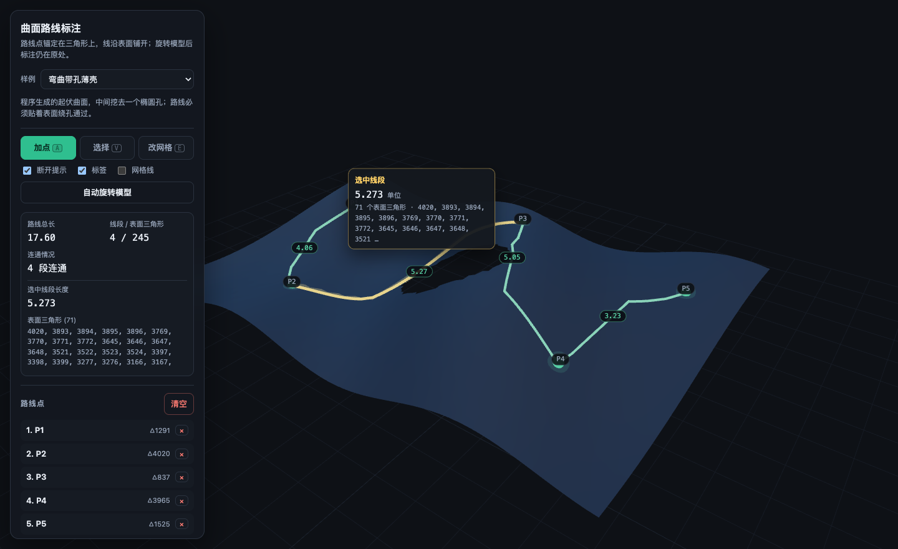

# 曲面路线标注（TypeScript + Three.js）

一个在程序生成的弯曲三角网格表面上放置、拖动路线点的小工具。路线沿着**表面三角形**连接成折线，而不是空间里的直线；旋转模型后，线、点、长度标签仍然贴在原来的表面上。



## 快速开始

```bash
npm install
npm run dev        # 打开 http://127.0.0.1:5173/
```

一条可运行的验证命令（会启动 Vite + 无头 Chrome，跑完整链路并截图到 `artifacts/smoke.png`）：

```bash
npm run verify     # = typecheck + 单元测试 + 浏览器端到端冒烟测试
```

只跑其中一项：

```bash
npm run test       # Vitest：路径算法、增量更新、存档校验
npm run smoke      # 端到端；可用 CHROME_PATH=/path/to/chrome 指定浏览器
```

## 怎么用

| 操作 | 说明 |
| --- | --- |
| **加点（A）** | 在表面上单击添加路线点；若当前选中了某条线段，则把点插入到该线段中间 |
| **选择（V）** | 单击/拖动路线点；单击线段查看长度与经过的表面三角形 |
| **改网格（E）** | 单击网格顶点，出现沿法线的箭头；拖动即在该处鼓包，只重算受影响的线路 |
| 鼠标 | 左键旋转、右键平移、滚轮缩放 |
| 自动旋转模型 | 让模型绕自身 Y 轴转，用来肉眼确认标注跟着表面走 |
| 保存 / 载入 | 下载或读入 JSON：相机姿态、模型旋转、路线点、网格顶点偏移 |

## 需求对应实现

### 1. 程序生成的弯曲网格 + 放点 / 移动点

`src/core/samples.ts` 用高度场函数 `waveA/waveB` 三角化出曲面。点不是存世界坐标，而是存**锚点**：

```ts
interface SurfaceAnchor { tri: number; bary: [number, number, number] }
```

即「第几个三角形 + 重心坐标」。因此移动、旋转、缩放整个模型后，点仍然精确落在那块表面上（`SurfaceMesh.anchorPosition`）。

### 2. 沿曲面连接，不穿模、不跨孔

`SurfaceMesh.findPath` 分三步：

1. **A\*** 在三角形对偶图上搜索一条走廊。只有真正共享一条边的三角形才相邻；孔洞处没有面，边界处没有邻接，所以走廊不可能跨过去。
2. 对每条公共边采样若干点，用**动态规划**求全局更短的穿越点组合，再做几轮连续坐标下降（`tauten`）细化。
3. 相邻两个穿越点一定同属某个三角形，因此每一小段都精确落在该三角形平面内 —— 线段不会插进模型内部。渲染时只沿顶点法线抬高 `0.02` 避开 z-fighting。

路径同时记录 `triangles`（经过的表面三角形）和 `pointTriangles`（每个小段所属三角形），并由 `validatePath()` 做逐点自检。

### 3. 显示长度与对应的表面三角形

- 每条线段中点浮出长度标签；单击线段后：
  - 面板显示精确长度、经过的三角形数量与完整列表；
  - 模型上浮出测量卡片，并高亮该线段经过的所有表面三角形。
- 长度是沿表面折线的欧氏长度累加，不是两端点的直线距离。

### 4. 编辑网格点只更新受影响的线路、无残留

`RouteModel.updateAfterVertexEdit(affectedTriangles)`：

- 端点锚定在受影响三角形上的线段 → 重算；
- 路径经过的三角形集合与受影响集合相交的线段 → 重算；
- 其它线段连 `revision` 都不变。

渲染层 `ThreeView.syncSegment` 每次都会**销毁旧的 `Line2` 再重建**，`syncRoute` 还会删除快照里已不存在的线段对象。因此不存在“新线画上去、旧线还留着”的情况。

### 5. 跨面 / 断开表面、保存恢复

- 双岛样例由两块互不连通的网格组成。跨岛线段返回 `{ ok: false, reason: 'disconnected' }`，界面画黄色虚线与“断开”标签，**不会**画一条穿空气的直线，长度记为 0。
- 存档 schema（`src/core/persistence.ts`）包含：样例 id、相机位置/目标/上方向/FOV、模型自身旋转、路线点锚点、网格顶点相对基础形状的偏移、当前选中点。载入时逐字段校验，坏点计数丢弃；恢复流程会重建网格与路线，旧路线整体替换。

## 项目结构

```
src/
  core/                 # 与 Three.js 渲染无关的纯逻辑，可单独测试
    types.ts            # SurfaceAnchor / SegmentPath 等类型
    SurfaceMesh.ts      # 邻接、连通分量、A*、贴面折线、顶点编辑
    RouteModel.ts       # 路线点与线段的状态机、增量重算
    samples.ts          # 程序生成的两个样例（含孔洞 / 断开）
    persistence.ts      # 存档 schema 与校验
  app/
    ThreeView.ts        # Three.js 场景、拾取、标签、测量卡片、拖动手柄
  main.ts               # UI 装配、交互、window.__routeApp 调试入口
tests/                  # Vitest
scripts/smoke.mjs       # Playwright 端到端验证
```

## 自动化入口

浏览器里 `window.__routeApp` 暴露了只读摘要和操作句柄（`getSummary`、`getSegments`、`editVertexNear`、`rotateModelY`、`maxPathDeviation` 等），端到端测试就是通过它验证：

- 折线逐点都在所属三角形平面上、且不越出三角形（`maxPlaneDeviation < 1e-5`）；
- 路线经过的三角形重心不在孔洞内部；
- 旋转模型后标注到表面的距离不变；
- 改一个顶点后只有相关线段 `revision` 变化，可视对象数量不增长；
- 保存 → 切样例 → 恢复后总长度、三角形集合、相机、模型旋转完全一致；
- 真实的 `mouse.down/move/up` 拖动路线点、`mouse.click` 加点、“改网格”模式下点顶点并拖动手柄都能走通。

## 环境要求

- Node.js ≥ 20（开发使用 22/26 验证）
- 任一本机 Chrome / Chromium 供 `npm run smoke` 使用；缺失时可用 `CHROME_PATH` 指定
