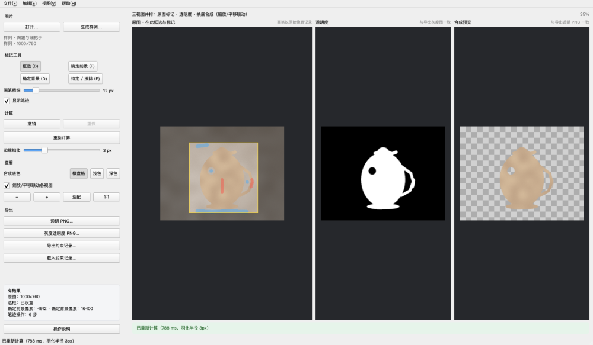
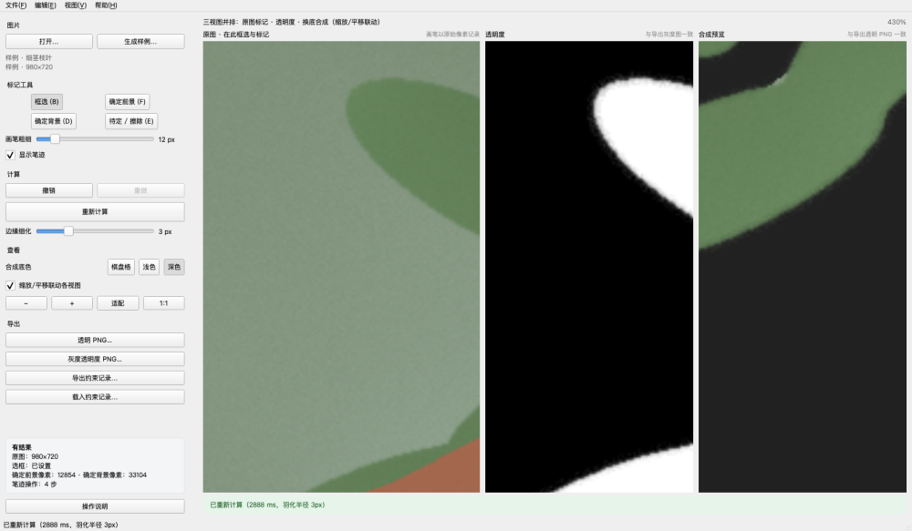
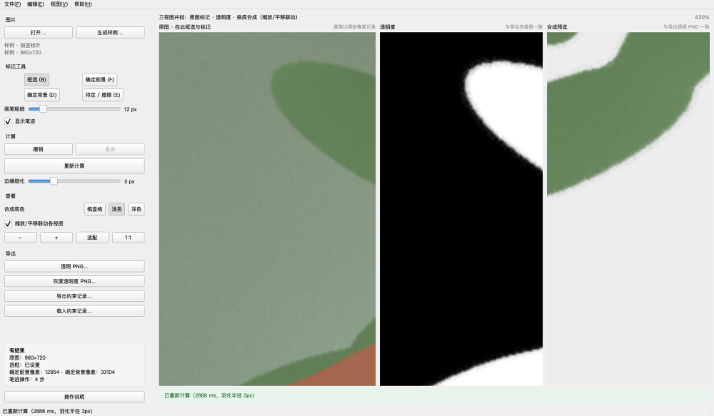
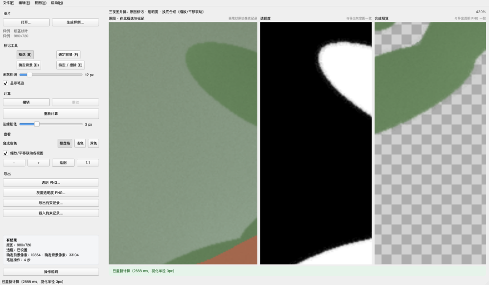

# ScribbleMatte · 静物抠图

一个**纯本地**的桌面抠图工具：框选前景大致范围，再用「确定前景 / 确定背景 / 待定」三类画笔纠正结果，
生成前景与透明度，导出透明 PNG、灰度透明度图和约束记录。

- Python + PySide6 + OpenCV + NumPy
- 只处理**静态图片**（PNG / JPEG），不涉及视频、绿幕
- 不使用任何外部素材或分割模型；内置样例由程序即时生成，附带参考透明度



目标范围：普通不透明 / 半哑光物体及其抗锯齿、柔和边缘。
**不**承诺玻璃、烟雾、复杂发丝这类需要专门 matting 模型的材质。

---

## 1. 安装与环境

要求 Python 3.10+（开发与验证使用 Python 3.12）。

```bash
cd repo
python3 -m venv .venv
./.venv/bin/pip install -r requirements.txt
```

`requirements.txt` 只需 `PySide6`、`opencv-python`、`numpy`；
`pytest` / `pytest-timeout` 仅用于运行验证。

依赖安装完成后整个程序离线可用，不会联网、不上传图片。

## 2. 启动

```bash
./run.sh                       # 首次运行会自动建 .venv 并安装依赖
# 或
./.venv/bin/python app.py
```

可选：`QT_QPA_PLATFORM=offscreen ./.venv/bin/python app.py` 在无显示环境做冒烟测试。

## 3. 操作流程

1. **打开图片**（`Ctrl+O`，或直接把文件拖进窗口）
   - 支持 PNG / JPEG；长边超过 1200 像素会自动按比例缩到 1200，界面显示实际工作尺寸。
2. **框选**（快捷键 `B`）：按住左键拖出包住物体的矩形。
   - 框外像素一律视为背景；框太小（< 24 px 或 < 全图 0.2%）会被拒绝并提示。
3. **画标记**
   - `F` 确定前景：在物体内部画几笔（必须完全不透明）。
   - `D` 确定背景：在物体外的背景上画几笔（必须完全透明）。
   - `E` 待定 / 擦除：把已有笔迹擦回「待定」，交给算法依图像内容判断。
   - 画笔粗细用滑杆或 `[` / `]` 调整；`L` 显示/隐藏笔迹。
4. **重新计算**（`Ctrl+Enter`）。失败时笔迹和上一次的有效结果都会保留，并给出具体原因。
5. 结果不满意就继续补画 / 擦除，再重新计算。**每次计算只以原图 + 当前约束为准**，
   不会把上次裁掉的背景当作输入（见第 6、7 节）。
6. **查看**：右侧并排显示三视图——原图（可标记）、透明度、换底合成。
   - 合成视图可切换 **棋盘格 / 浅色 / 深色** 底色。
   - 滚轮以光标为中心缩放；`Alt`/右键/中键拖动或按住空格拖动平移；
     `+` / `-` / `0`（适配）/ `1`（实际像素）；三个视图缩放平移联动。
7. **撤销 / 重做**：`Ctrl+Z` / `Ctrl+Shift+Z`。**一次连续笔划算一步**。
8. **导出**
   - 透明 PNG（RGBA，直通 alpha）
   - 灰度透明度 PNG
   - 约束记录 JSON
9. **载入约束记录**：先打开同一张原图，再载入 JSON 即可继续修改。

### 快捷键

| 键 | 功能 | 键 | 功能 |
|---|---|---|---|
| `B` / `F` / `D` / `E` | 框选 / 确定前景 / 确定背景 / 擦除 | `Ctrl+Z` / `Ctrl+Shift+Z` | 撤销 / 重做 |
| `Ctrl+Enter` | 重新计算 | `[` / `]` | 画笔变细 / 变粗 |
| `+` / `-` | 放大 / 缩小 | `0` / `1` | 适配窗口 / 实际像素 |
| 空格拖动、中键、右键、`Alt`+左键 | 平移 | `L` | 显示 / 隐藏笔迹 |

## 4. 内置样例（自生成，无需外部附件）

工具栏「生成样例…」打开画廊，点击任一样例会一并恢复它自带的**选框、前景笔迹、背景笔迹**并立即计算：

| 样例 | 难点 |
|---|---|
| 陶罐与细把手 | 前背景同色系、细窄把手、罐身透出的圆孔 |
| 细茎枝叶 | 极细茎干连接多个叶片、背景同色渐变 |
| 带孔圆环 | 大面积内部孔洞、薄环壁、孔内细桥连接 |

样例由 `matting/samples.py` 用 OpenCV 在 4 倍超采样画布上矢量绘制后降采样，
再做轻微光学模糊，因此带有真实的抗锯齿柔和边缘；参考透明度 `alpha` 与图像同时生成。
生成是确定性的（固定随机种子），同一份代码每次得到完全相同的图。

## 5. 导出内容

| 文件 | 内容 |
|---|---|
| `*_foreground.png` | RGBA。RGB 为**去背景污染**后的前景颜色，A 为透明度 |
| `*_alpha.png` | 8 位灰度透明度图，`round(alpha*255)` |
| `*_constraints.json` | 原图尺寸、SHA-256 内容校验、选框、设置、全部笔迹 |

**预览与导出的一致性**：透明度视图直接渲染 `alpha`；合成视图与导出使用**同一个**
`composite()` / `ensure_bgra()`；导出的 RGBA 在任意底色上重新合成，与界面合成结果逐像素一致（误差 ≤ 1 级）。

**柔和边缘不发黑**：计算阶段用归一化盒滤波估计局部背景色，按 `I = αF + (1-α)B` 反解出直通前景色 F；
完全透明的像素填充邻近物体颜色而不是黑色。因此换深色底时不会出现黑边
（`tests/test_record_export.py::test_exported_edge_has_no_black_fringe`）。

**预览过期保护**：任何会影响结果的输入（原图、选框、笔迹、细化半径、GrabCut 迭代次数）变化后，
「重新计算」按钮会变成「重新计算（预览已过期）」。导出时若预览过期，会先弹窗提示并要求先计算。

同一处边缘放大 12 倍后的合成预览，可对照是否出现黑边：

深色底 

浅色底 

棋盘格 

## 6. 算法说明（为什么满足需求 2、3、5）

`matting/engine.py::compute_matting(image, labels, settings)` 是纯函数：

1. **校验**：选框尺寸、图内是否有前景/背景标记、全图是否近乎单色。
2. **GrabCut**（`GC_INIT_WITH_MASK`）：框内为「可能是前景」，用户笔迹为硬约束。
   每次调用前固定 OpenCV RNG 种子，**同一输入逐像素可复现**。
3. **硬约束回写**：确定前景 = 1、确定背景 = 0、框外 = 0，不受 GrabCut 结果影响。
4. **柔边细化**：在二值边界两侧构造窄带，用局部前景/背景颜色做颜色线投影求 α，
   再用导向滤波只平滑该窄带，保留抗锯齿过渡。
5. **前景去污染**：按上式反解 F，供合成与导出使用。

关键点：函数签名里**没有「上一次 alpha」参数**；撤销一笔再重算会得到与之前**逐位相同**的结果
（`tests/test_constraints.py::test_recompute_uses_only_original_and_constraints`）。

## 7. 验证（关键硬约束、缩放定位、撤销恢复、PNG 回读）

```bash
./.venv/bin/python verify.py            # pytest + 独立自检
# 或分开跑
./.venv/bin/python -m pytest tests -q
./.venv/bin/python selfcheck.py
```

`verify.py` 期望输出末行 `全部检查通过`。

### 自动化覆盖的硬约束

| 验证点 | 位置 |
|---|---|
| 确定前景全部不透明 / 确定背景全部透明 / 框外透明 | `test_constraints.py::test_hard_constraints` |
| 与参考透明度 IoU ≥ 0.90、MSE ≤ 0.01（三个样例） | `test_constraints.py::test_sample_quality` |
| 重新计算逐位可复现、接口不接受上次结果 | `test_constraints.py::test_deterministic_recompute`、`test_recompute_uses_only_original_and_constraints` |
| 撤销一笔后结果回到与之前逐位相同 | 同上 |
| 一次连续笔算一步；撤销后新笔画清空重做分支 | `test_one_gesture_one_undo`、`test_new_stroke_drops_redo_branch` |
| 擦除回「待定」 | `test_eraser_clears_labels` |
| 柔和边缘存在且深色底无黑边 | `test_soft_edges_exist`、`test_no_dark_fringe_on_dark_backdrop`、`test_exported_edge_has_no_black_fringe` |
| 缺前景 / 缺背景 / 选框太小 / 单色图 给出明确错误码 | `test_missing_marks_errors`、`test_tiny_box_error`、`test_uniform_image_error` |
| 失败保留笔迹与上次有效结果 | `test_failure_keeps_history` |
| 新图加载清空旧约束、不把旧结果当作已完成 | `test_new_image_clears_old_constraints` |
| **放大后笔迹落回正确原图像素**（1x 与 4x 绘制覆盖相同像素） | `test_interaction.py::test_zoomed_brush_lands_on_original_pixels` |
| 真实鼠标事件下的框选、擦除、缩放联动 | `test_interaction.py` 其余用例 |
| 记录的尺寸 + SHA-256 校验，同尺寸不同像素也拒绝套用 | `test_record_export.py::test_record_rejects_*` |
| 载入记录后仍标记为未计算（不当作已完成） | `test_document_load_record_marks_stale` |
| **透明 PNG 回读的 alpha 与计算结果一致** | `test_transparent_png_alpha_matches_preview` |
| 预览与导出合成逐像素一致 | `test_composite_preview_equals_export` |
| 预览过期阻止导出 | `test_interaction.py::test_main_window_blocks_export_when_stale` |

### 端到端 GUI 走查（可选）

```bash
QT_QPA_PLATFORM=offscreen ./.venv/bin/python gui_walkthrough.py --outdir .demo
```

它会用真实鼠标事件依次执行：加载样例 → 撤销 / 重做（观察「预览已过期」）→ 放大后补画 →
重新计算 → 切换三种底色并截图 → 导出三种文件 → 加载新样例（确认旧约束被清空）→
重新载入记录 → 放大状态下点击并核对记录坐标与落点标签，最后打印一份 JSON 结果。
（`.demo/` 已在 `.gitignore` 中。）

### 已知边界

- 样例边界允许合理误差：细把手最外侧贴背景的一小段可能被裁掉 1–3 像素。
- 全透明区域的颜色由邻近前景颜色外推，只影响半透明边缘的显示，不影响 alpha。
- 不适用于玻璃、透明液体、毛发等需要专门 matting 模型的材质。

## 8. 性能参考

本机（Apple Silicon，Python 3.12，OpenCV 5.1）在三个内置样例上：

| 样例 | 尺寸 | 计算耗时 | 与参考透明度 IoU |
|---|---|---|---|
| 陶罐与细把手 | 1000×760 | ~0.7 s | 0.995 |
| 细茎枝叶 | 980×720 | ~3 s | 0.978 |
| 带孔圆环 | 900×760 | ~0.6 s | 0.994 |

细茎样品最慢，因为细结构让 GrabCut 需要更多迭代。计算在 UI 线程同步执行；
超过约 1200 像素的图片会先缩到长边 1200 再处理。

## 9. 目录结构

```
app.py                 启动入口
run.sh                 一键建环境并启动
verify.py              一键验证（pytest + selfcheck）
selfcheck.py           无需 GUI 的硬约束自检
gui_walkthrough.py     offscreen 端到端 GUI 走查
matting/
  constraints.py       标记类型、笔迹、撤销/重做（StrokeHistory）
  engine.py            提交输入校验 + GrabCut + 柔边细化 + 前景去污染
  samples.py           自生成样例与参考透明度
  imageio.py           合成、棋盘格、PNG 读写、内容指纹
  record.py            约束记录 JSON、校验、过期检测
ui/
  canvas.py            缩放 / 平移 / 画笔 / 框选画布（坐标全部回落到原图像素）
  document.py          文档状态与重算/失败/过期逻辑
  main_window.py       主窗口、快捷键、三个并排视图
  sample_gallery.py    样例画廊
  exports.py           导出封装
tests/                 pytest 用例
docs/screenshots/      文档截图
```
